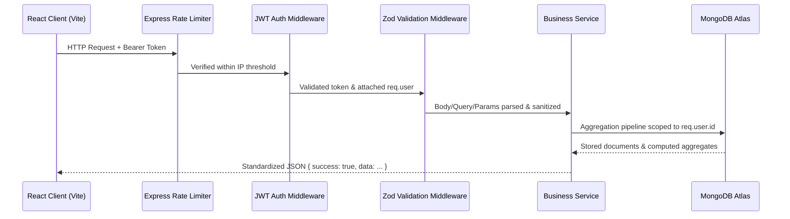

# 💸 Spendly — Full-Stack Personal Finance & Expense Manager

Spendly is an enterprise-grade, full-stack personal finance and expense management application built for a MERN internship assessment. All financial summaries, category distributions, budget alerts, and account balances are computed in real time from stored MongoDB documents using high-performance aggregation pipelines. Strict multi-tenant user isolation is enforced at the database layer.

---

## 🌐 Live Deployments

| Service | Platform | URL |
|---|---|---|
| **Frontend Web App** | Vercel | [https://client-two-omega-68.vercel.app](https://client-two-omega-68.vercel.app) |
| **Backend REST API** | Render | [https://spendly-axn5.onrender.com](https://spendly-axn5.onrender.com) |
| **API Health Status** | Render | [https://spendly-axn5.onrender.com/api/v1/health](https://spendly-axn5.onrender.com/api/v1/health) |

> ⏳ **Render Free-Tier Notice:** The backend web service on Render spins down into sleep mode after 15 minutes of inactivity. When accessed after an idle period, the first API request may take approximately 30–60 seconds while the container initializes.

---

## 📋 Table of Contents

- [Features](#-features)
- [Tech Stack](#-tech-stack)
- [Architecture & Request Flow](#-architecture--request-flow)
- [Prerequisites](#-prerequisites)
- [Installation Guide](#-installation-guide)
- [Configuration & Environment Variables](#-configuration--environment-variables)
  - [Backend Configuration](#1-backend-configuration-serverenv)
  - [Frontend Configuration](#2-frontend-configuration-clientenv)
  - [Third-Party Integrations Setup](#3-third-party-integrations-setup)
- [Running the Project](#-running-the-project)
- [Database Seeding](#-database-seeding-demo-data)
- [Deployment Guide](#-deployment-guide)
  - [Deploying Backend to Render](#deploying-backend-to-render)
  - [Deploying Frontend to Vercel](#deploying-frontend-to-vercel)
- [Testing & Quality Assurance](#-testing--quality-assurance)
- [API Reference](#-api-reference)
- [Data Models](#-data-models)
- [Security Architecture](#-security-architecture)
- [Troubleshooting & FAQ](#-troubleshooting--faq)
- [Known Limitations](#-known-limitations)

---

## ✨ Features

- **📧 Email OTP Account Verification:** Registration requires a 6-digit OTP code sent via Gmail SMTP. Codes are securely hashed and managed with MongoDB TTL indexes that automatically expire in 10 minutes.
- **📊 Real-Time Financial Dashboard:** View all-time net balance, monthly income, monthly expenses, budget status, 8 recent transactions, and a 6-month historical cash flow chart.
- **💳 Multi-Account Net Worth Tracking:** Manage multiple accounts (`Cash`, `Bank Account`, `Credit Card`, `Wallet`, `Savings`). Account balances are calculated dynamically from transactions as `sum(income) - sum(expense)`.
- **🏷️ Default & Custom Categories:** Comes preloaded with standard categories (Food, Travel, Bills, Salary, Business, etc.) and allows users to create, update, and manage custom categories with icons.
- **📝 Transaction Management:** Create, view, update, and delete transactions with accounts, categories, custom dates, notes, and receipt attachments.
- **🔎 Combinable Filtering & Search:** Filter transaction history by type, category, account, date range, and amount range. Debounced search performs case-insensitive regex matching across notes and categories, and exact matching on amounts.
- **📄 CSV Export with Injection Shield:** Export filtered transactions directly to CSV with proper header formatting (`Date,Type,Category,Account,Amount,Note`). Prevents formula injection by prepending a quote (`'`) to fields starting with `=`, `+`, `-`, or `@`.
- **🎯 Dynamic Budget Status & Warnings:** Track monthly budgets overall and by category with real-time warning indicators computed directly on the server:
  - `< 50%`: `ok` (Normal)
  - `50% - 74%`: `info` (50% budget consumed)
  - `75% - 89%`: `warning` (75% budget warning)
  - `90% - 99%`: `danger` (90% budget critical alert)
  - `≥ 100%`: `exceeded` (Exceeded notification with exact dollar overspend)
- **🔁 Automated Recurring Engine:** Schedule daily, weekly, monthly, or yearly recurring rules. The background engine catches up missed occurrences automatically on login or API requests (throttled to once per hour using atomic operations).
- **🏆 Savings Goals:** Set financial milestones with target amounts and target dates. Track progress percentages and contribute funds incrementally.
- **📈 Advanced Analytics:** Visual expense breakdown with interactive donut charts and multi-interval cash flow trendlines (`week`, `month`, `3months`, `year`).
- **📱 Responsive & Accessible UI:** Seamless experience on desktop and mobile. Features collapsible sidebar navigation, mobile drawer backdrops, loading skeletons, empty states, and toast notifications.

---

## 🛠 Tech Stack

| Domain | Technologies |
|---|---|
| **Backend** | Node.js 20+, Express 4 (ES Modules), Mongoose 8, Zod, bcryptjs, jsonwebtoken, Helmet, CORS, Express-Rate-Limit, Morgan, date-fns, Multer |
| **Frontend** | React 18, Vite, React Router 6, Tailwind CSS, Recharts, Lucide React, Axios, date-fns, React Hook Form + Zod resolver |
| **Database** | MongoDB Atlas (Production) / Local MongoDB (Development) |
| **Email Service** | Nodemailer (Gmail SMTP TLS) |
| **Cloud Storage** | Cloudinary SDK (Receipt attachments) |
| **Testing** | **Backend:** Jest, Supertest, mongodb-memory-server<br>**Frontend:** Vitest, React Testing Library, @testing-library/user-event, jsdom |
| **Hosting** | **Backend:** Render Web Service<br>**Frontend:** Vercel SPA |

---

## 🏗 Architecture & Request Flow

```
spendly/
├── server/
│   ├── src/
│   │   ├── app.js               # Express application configuration & security middleware
│   │   ├── server.js            # Database bootstrap and HTTP server listener
│   │   ├── config/              # env.js (Zod-validated environment), db.js (MongoDB connection)
│   │   ├── controllers/         # Thin HTTP request/response handlers
│   │   ├── middleware/          # auth, validate, errorHandler, rateLimiters, notFound
│   │   ├── models/              # User, Account, Category, Transaction, Budget, Goal, RecurringRule, EmailVerification
│   │   ├── routes/              # Express API routers (auth, accounts, transactions, etc.)
│   │   ├── services/            # Core business logic: analytics, budgetStatus, recurring, csv, email, cloudinary
│   │   ├── utils/               # AppError, asyncHandler, escapeRegex, constants
│   │   ├── validators/          # Strict Zod schemas for body, query, and params
│   │   └── tests/               # Jest & Supertest integration and unit test suites
│   └── scripts/
│       └── seed.js              # Realistic demo dataset seeder
└── client/
    ├── src/
    │   ├── api/                 # Axios HTTP client with Bearer token interceptor
    │   ├── components/          # Reusable UI primitives, Layout, Modals, Charts
    │   ├── context/             # AuthContext (user, tokens, state), ToastContext
    │   ├── hooks/               # useDebounce, custom query hooks
    │   ├── pages/               # Dashboard, Transactions, Analytics, Accounts, Budgets, Recurring, Goals, Settings, Login, Register
    │   ├── routes/              # ProtectedRoute and PublicRoute wrappers
    │   └── tests/               # Vitest component unit test suites
    └── vercel.json              # Single-page application route rewrite configuration
```

### Request Lifecycle


---

## 📦 Prerequisites

Ensure the following tools are installed on your machine:
- **Node.js**: `v20.0.0` or higher ([Download](https://nodejs.org/))
- **npm**: `v10.0.0` or higher
- **Git**: Installed and available in your system PATH
- **MongoDB**: A free MongoDB Atlas cluster account ([MongoDB Atlas](https://www.mongodb.com/cloud/atlas)) or a local MongoDB server instance
- **Gmail Account**: (Optional for email OTP) A Google account with 2-Step Verification and an **App Password**
- **Cloudinary Account**: (Optional for attachments) A free Cloudinary account ([Cloudinary](https://cloudinary.com/))

---

## 🚀 Installation Guide

### 1. Clone the Repository
```bash
git clone https://github.com/Abdullla-Tamboli/spendly.git
cd spendly
```

### 2. Install Server Dependencies
```bash
cd server
npm install
```

### 3. Install Client Dependencies
```bash
cd ../client
npm install
```

---

## ⚙️ Configuration & Environment Variables

### 1. Backend Configuration (`server/.env`)
Create a `.env` file in the `server/` directory by copying `.env.example`:
```bash
cd server
cp .env.example .env
```

Populate `server/.env` with your values:
```ini
# Environment Mode
NODE_ENV=development
PORT=5000

# Database Connection (MongoDB Atlas or local)
MONGODB_URI=mongodb+srv://<username>:<password>@cluster0.mongodb.net/spendly?retryWrites=true&w=majority

# Authentication Secrets
JWT_SECRET=your-secure-random-secret-key-at-least-32-chars-long
JWT_EXPIRES_IN=1d

# Allowed Frontend Origins (comma-separated for local + production)
CLIENT_ORIGIN=http://localhost:5173,https://client-two-omega-68.vercel.app

# Email OTP Delivery (Gmail SMTP)
EMAIL_HOST=smtp.gmail.com
EMAIL_PORT=587
EMAIL_USER=your-email@gmail.com
EMAIL_APP_PASSWORD=your-google-app-password

# Optional: Cloudinary (Receipt Attachments)
CLOUDINARY_CLOUD_NAME=your_cloud_name
CLOUDINARY_API_KEY=your_api_key
CLOUDINARY_API_SECRET=your_api_secret
```

### 2. Frontend Configuration (`client/.env`)
Create a `.env` file in the `client/` directory:
```bash
cd ../client
cp .env.example .env
```

For **local development** against your local server:
```ini
VITE_API_URL=http://localhost:5000/api/v1
```

For **testing against the live Render server**:
```ini
VITE_API_URL=https://spendly-axn5.onrender.com/api/v1
```

---

### 3. Third-Party Integrations Setup

#### Setting up MongoDB Atlas:
1. Create a free M0 cluster at [mongodb.com/atlas](https://www.mongodb.com/atlas).
2. Under **Security** > **Database Access**, create a user with `Read and write to any database` privileges.
3. Under **Security** > **Network Access**, click **Add IP Address** and add `0.0.0.0/0` (Allow access from anywhere) so that Render can connect.
4. Click **Connect** > **Drivers** > copy the connection string into `MONGODB_URI`.

#### Setting up Gmail SMTP for OTP Verification:
1. Go to your [Google Account Security settings](https://myaccount.google.com/security).
2. Ensure **2-Step Verification** is turned **ON**.
3. In the search bar at the top of Google Account, search for **"App passwords"**.
4. Create a new App Password named `Spendly`.
5. Copy the generated 16-character string into `EMAIL_APP_PASSWORD` in `server/.env` (without spaces), and set `EMAIL_USER` to your Gmail address.

#### Setting up Cloudinary (Optional):
1. Sign up at [cloudinary.com](https://cloudinary.com/).
2. On your Dashboard, copy the **Cloud Name**, **API Key**, and **API Secret** into `server/.env`.
3. If omitted, receipt attachment buttons are automatically hidden and the server responds with a clear `501 Not Implemented`.

---

## 💻 Running the Project

### Running in Development Mode

You will need two terminal windows:

#### Terminal 1: Backend Server
```bash
cd server
npm run dev
```
The server will start with Nodemon at **`http://localhost:5000`**. You can verify it by opening `http://localhost:5000/api/v1/health`.

#### Terminal 2: Frontend Web App
```bash
cd client
npm run dev
```
Vite will start the client at **`http://localhost:5173`**.

---

### Running Production Builds Locally

To verify production builds before deploying:

#### Build & Run Backend:
```bash
cd server
npm start
```

#### Build & Preview Frontend:
```bash
cd client
npm run build
npm run preview
```

---

## 🌱 Database Seeding (Demo Data)

To populate the database with realistic demo data for presentations or testing:
```bash
cd server
npm run seed
```

This script writes real documents to your MongoDB instance:
- **Demo User:** `demo@spendly.dev` / `DemoPassword123`
- **Default & Custom Accounts:** Cash, Main Checking, Credit Card, High-Yield Savings
- **6 Months of Historical Transactions:** Groceries, Rent, Utilities, Dining, Salary, Freelance income
- **Active Budgets:** Overall monthly budget + per-category budgets
- **Savings Goals:** Emergency Fund, Vacation Fund with contributions
- **Recurring Transactions:** Monthly Netflix subscription, Monthly Salary

---

## 🚢 Deployment Guide

### Deploying Backend to Render

1. Create a free account at [render.com](https://render.com/).
2. Click **New +** > **Web Service** and connect your GitHub repository `spendly`.
3. Configure the service settings:
   - **Name:** `spendly-api` (or custom name)
   - **Region:** Choose the region closest to you
   - **Root Directory:** `server`
   - **Environment:** `Node`
   - **Build Command:** `npm install`
   - **Start Command:** `npm start`
   - **Plan:** `Free`
4. In the **Environment Variables** tab, add:
   - `NODE_ENV` = `production`
   - `PORT` = `5000`
   - `MONGODB_URI` = `<your-mongodb-atlas-connection-string>`
   - `JWT_SECRET` = `<a-secure-random-string-at-least-32-chars>`
   - `JWT_EXPIRES_IN` = `1d`
   - `CLIENT_ORIGIN` = `https://<your-vercel-app>.vercel.app,http://localhost:5173`
   - `EMAIL_HOST` = `smtp.gmail.com`
   - `EMAIL_PORT` = `587`
   - `EMAIL_USER` = `<your-gmail-address>`
   - `EMAIL_APP_PASSWORD` = `<your-16-char-app-password>`
5. Click **Create Web Service**. Your backend will deploy to a URL like `https://spendly-xxxx.onrender.com`.

---

### Deploying Frontend to Vercel

1. Create an account at [vercel.com](https://vercel.com/).
2. Click **Add New...** > **Project** and import the `spendly` repository.
3. Configure the deployment settings:
   - **Framework Preset:** `Vite`
   - **Root Directory:** Click **Edit** and set it to **`client`** (critical step).
   - **Build Command:** `npm run build`
   - **Output Directory:** `dist`
   - **Install Command:** `npm install`
4. Expand **Environment Variables** and add:
   - `VITE_API_URL` = `https://<your-render-app>.onrender.com/api/v1`
5. Click **Deploy**. Vercel will build and provide your live frontend URL.
6. The included [client/vercel.json](file:///e:/spendly/client/vercel.json) automatically handles SPA rewrites so direct navigation to `/transactions` or page refreshes resolve cleanly without 404 errors.

---

## 🧪 Testing & Quality Assurance

Spendly includes comprehensive automated test suites for both the backend and frontend.

### 1. Backend Integration Tests (Jest + Supertest + In-Memory MongoDB)
```bash
cd server
npm test
```
- **128 Passing Tests Across 9 Suites**:
  - `auth.test.js`: Registration, login, duplicate email prevention, weak password rejection, timing-attack resilience, token expiration.
  - `otp.test.js`: Verification code generation, delivery, TTL expiration, invalid code rejection.
  - `transactions.test.js`: Full CRUD happy paths, boundary validations, default date fallbacks, backend pagination.
  - `isolation.test.js`: **Critical User Isolation Guarantee** — verifies that User B cannot read, edit, or delete User A's transactions, accounts, budgets, or goals (returns `404 Not Found`).
  - `accounts-categories.test.js`: Balance aggregations, custom category management, 409 conflict checks.
  - `budgets-analytics-dashboard.test.js`: Overall budget warnings (50%, 75%, 90%, 100%+), cash flow charts, category breakdown percentages.
  - `recurring-goals.test.js`: Catch-up processor, duplicate execution prevention, goal contribution logic.
  - `csv.test.js`: Filter application, exact header compliance, formula injection sanitization.
  - `foundation.test.js`: Error handler, rate limiters, health route, strict Zod middleware.

### 2. Frontend Component Tests (Vitest + React Testing Library)
```bash
cd client
npm test
```
- **15 Passing Tests**:
  - `LoginForm`: Field validations, credential submission, error banner display, loading states.
  - `Register`: Name/Email/Password validation, step transition, OTP code input handling.
  - `TransactionForm`: Today's date default, numeric amount enforcement, recurring field reveal.
  - `TransactionList` & Filters: Row rendering, pagination, filter parameter synchronization.
  - `BudgetProgress`: Accurate badge styling and warning message verification at 50%, 75%, 90%, and 100%+.
  - `ProtectedRoute`: Unauthorized redirection to `/login` with return destination preservation.

---

## 📡 API Reference

All protected endpoints require an `Authorization: Bearer <token>` header.

### Authentication & Account
| Method | Endpoint | Description | Auth |
|---|---|---|---|
| `GET` | `/api/v1/health` | Service health status & attachments readiness | No |
| `POST` | `/api/v1/auth/send-registration-otp` | Deliver 6-digit registration code to email | No |
| `POST` | `/api/v1/auth/register` | Verify OTP code & create account with default accounts | No |
| `POST` | `/api/v1/auth/login` | Authenticate user & return JWT token | No |
| `GET` | `/api/v1/auth/me` | Retrieve profile of currently authenticated user | Yes |
| `POST` | `/api/v1/auth/logout` | Client logout acknowledgement | Yes |

### Dashboard & Analytics
| Method | Endpoint | Description | Auth |
|---|---|---|---|
| `GET` | `/api/v1/dashboard` | Net balance, totals, active budget, recent transactions, cash flow | Yes |
| `GET` | `/api/v1/analytics?range=week\|month\|3months\|year` | Summary metrics, category breakdown %, and cash flow trends | Yes |

### Transactions
| Method | Endpoint | Description | Auth |
|---|---|---|---|
| `GET` | `/api/v1/transactions` | Paginated transaction history with combinable filters & search | Yes |
| `POST` | `/api/v1/transactions` | Create transaction (supports optional inline recurring rule) | Yes |
| `GET` | `/api/v1/transactions/:id` | Fetch single transaction by ID | Yes |
| `PUT` | `/api/v1/transactions/:id` | Update transaction details | Yes |
| `DELETE` | `/api/v1/transactions/:id` | Delete transaction | Yes |
| `GET` | `/api/v1/transactions/export` | Download filtered transactions as an injection-safe CSV file | Yes |
| `POST` | `/api/v1/transactions/:id/attachment` | Upload receipt image/PDF (max 2 MB) | Yes |

### Accounts & Categories
| Method | Endpoint | Description | Auth |
|---|---|---|---|
| `GET` | `/api/v1/accounts` | List accounts with aggregated balances & combined total | Yes |
| `POST` | `/api/v1/accounts` | Create financial account | Yes |
| `PUT` | `/api/v1/accounts/:id` | Update account name or type | Yes |
| `DELETE` | `/api/v1/accounts/:id` | Delete account (returns 409 if transactions exist) | Yes |
| `GET` | `/api/v1/categories` | List user custom & default categories | Yes |
| `POST` | `/api/v1/categories` | Create custom category | Yes |
| `PUT` | `/api/v1/categories/:id` | Rename or change icon for category | Yes |
| `DELETE` | `/api/v1/categories/:id` | Delete custom category (returns 409 if in use) | Yes |

### Budgets, Goals & Recurring
| Method | Endpoint | Description | Auth |
|---|---|---|---|
| `GET` | `/api/v1/budgets?month=YYYY-MM` | Fetch budget & computed spending levels for month | Yes |
| `PUT` | `/api/v1/budgets/:month` | Upsert overall & per-category monthly limits | Yes |
| `DELETE` | `/api/v1/budgets/:month` | Delete budget for a given month | Yes |
| `GET` | `/api/v1/goals` | List savings goals with computed progress % | Yes |
| `POST` | `/api/v1/goals` | Create savings goal | Yes |
| `PUT` | `/api/v1/goals/:id` | Update savings goal | Yes |
| `PATCH` | `/api/v1/goals/:id/contribute` | Add contribution towards goal | Yes |
| `DELETE` | `/api/v1/goals/:id` | Delete savings goal | Yes |
| `GET` | `/api/v1/recurring` | List active recurring transaction rules | Yes |
| `PATCH` | `/api/v1/recurring/:id` | Pause, resume, or edit recurring rule | Yes |
| `DELETE` | `/api/v1/recurring/:id` | Delete recurring rule | Yes |

---

## 🗄️ Data Models

All user-owned documents include a required `user: ObjectId` field and automatic timestamps (`createdAt`, `updatedAt`).

- **User:** `name`, `email` (lowercase, unique), `passwordHash` (`select: false`), `currency` (default `USD`), `lastRecurringCheck` (Date).
- **EmailVerification:** `email` (lowercase), `otpHash`, `expiresAt` (Date with 10-minute TTL index).
- **Account:** `user`, `name`, `type` (`cash`, `bank`, `credit_card`, `wallet`, `savings`). Balance is dynamically computed as `sum(income) - sum(expense)`.
- **Category:** `user`, `name`, `type` (`income`, `expense`), `icon` (string key from allowed icon set).
- **Transaction:** `user`, `account` (ref), `type` (`income`, `expense`), `amount` (Number, 2 decimals max), `category`, `note`, `date`, `attachment` (`{ url, publicId, mimeType }`), `recurringRule` (optional ref).
- **RecurringRule:** `user`, `account` (ref), `type`, `amount`, `category`, `note`, `frequency` (`daily`, `weekly`, `monthly`, `yearly`), `nextDate`, `endDate`, `active` (Boolean).
- **Budget:** `user`, `month` (string format `YYYY-MM`), `overall` (Number), `categories` (`[{ category, amount }]`).
- **Goal:** `user`, `name`, `targetAmount`, `currentAmount`, `targetDate`. Progress percentage is computed dynamically in responses.

---

## 🛡️ Security Architecture

1. **User Isolation (Hard Guarantee):** Every MongoDB read and write query filters explicitly by `user: req.user.id`. When a user attempts to access an entity belonging to another user, the API responds with `404 Not Found` (never `403`) to eliminate ID harvesting.
2. **Strict Zod Validations:** All inputs (`body`, `query`, `params`) pass through `.strict()` Zod schemas. Any unpermitted or unexpected fields are automatically rejected with `400 Bad Request`.
3. **NoSQL Injection Neutralized:** Because Zod validates that inputs match strict primitive types (e.g. `z.string()`, `z.number()`), complex operator injection payloads (like `{ "$gt": "" }` or `{ "$ne": null }`) fail validation before reaching Mongoose queries.
4. **Timing Attack Protection:** On login failure, the system executes a dummy bcrypt comparison if an email is not registered, preventing attackers from discerning whether an email exists based on response latency.
5. **Rate Limiting:** Auth routes are throttled to 10 requests / 15 minutes per IP; API endpoints are throttled to 300 requests / 15 minutes per IP.
6. **CSV Injection Defense:** If a text field starts with `=`, `+`, `-`, or `@`, it is prepended with a single quote (`'`) to neutralize malicious formula execution when opened in Excel or Google Sheets.
7. **HTTP Security Headers:** `helmet()` is active on all routes, and the `X-Powered-By` header is disabled.

---

## ❓ Troubleshooting & FAQ

#### 1. Why does the live app take 30–60 seconds to respond on the first load?
Render's free tier spins down idle containers after 15 minutes. The container will automatically wake up and respond normally to all subsequent requests.

#### 2. Why am I getting a CORS error in my browser?
Ensure your exact frontend URL (e.g. `https://client-two-omega-68.vercel.app`) is included in `CLIENT_ORIGIN` in your Render Environment Variables without trailing slashes. Note that Spendly's server also dynamically allows any `https://*.vercel.app` origin by default.

#### 3. Why are OTP verification emails not arriving?
- Verify that **2-Step Verification** is enabled on your Gmail account.
- Ensure you created an **App Password** (16 characters) and did not use your normal Gmail login password.
- Confirm `EMAIL_USER` and `EMAIL_APP_PASSWORD` are correctly set in `server/.env` (or Render environment variables).

#### 4. How do I reset or clear the local database?
You can delete test documents in MongoDB Atlas or re-run `npm run seed` in the `server/` directory to re-populate the demo dataset.

---

## ⚠️ Known Limitations

1. **Client-Side Token Storage:** JWT tokens are stored in `localStorage` for assessment convenience. In high-security enterprise environments, `httpOnly`, `SameSite=Strict` cookies with CSRF protection would be preferred.
2. **Lazy Recurring Processor:** Recurring transactions are generated dynamically upon user authentication or API requests (throttled to at most once per hour per user) rather than via an independent background cron daemon.
3. **Receipt Attachments:** Receipt uploads require valid Cloudinary environment credentials. If unconfigured, the endpoint returns `501 Not Implemented` and receipt buttons are hidden in the UI.
4. **Render Free-Tier Spin-Down:** Cold starts occur after 15 minutes of inactivity on Render's free tier.
